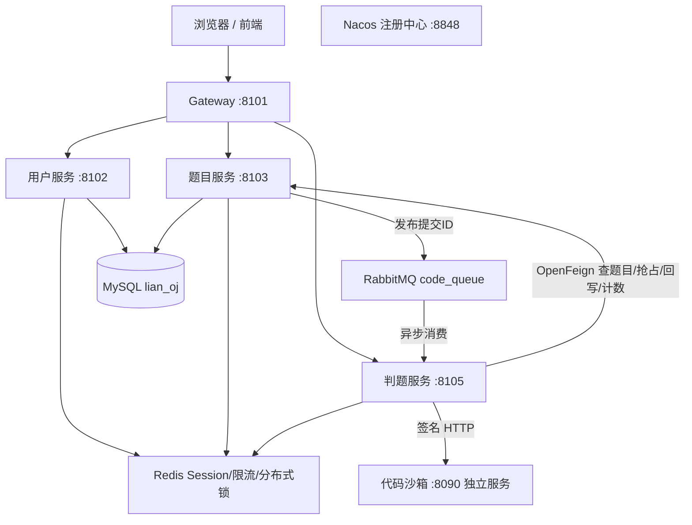
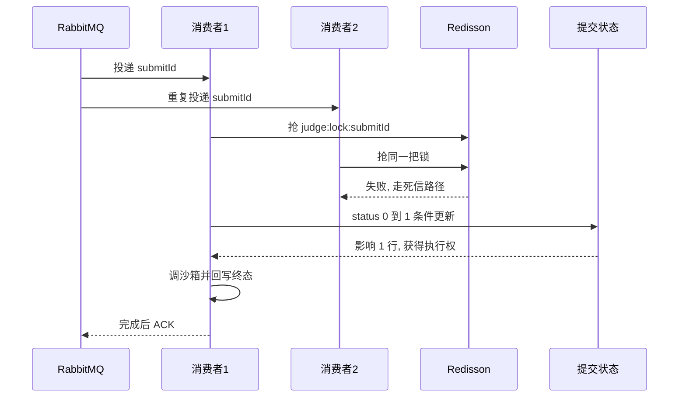

# lianoj-backend-microservice

> 面向编程练习的微服务在线判题系统 · 后端（配套独立[代码沙箱服务](#配套仓库)与前端）

      

一个支持 **Java / C++ / Python** 多语言判题、**SPJ 特判与 ACM/OI 赛制**、**异步判题与消息可靠性补偿**的在线判题系统后端。用户提交代码后立即返回，判题经消息队列异步执行，前端轮询获取判定结果（Accepted / Wrong Answer / 编译错误 / 超时 / 内存超限 / 危险操作）与耗时、内存、得分信息。

本项目在单体版本（见配套仓库）基础上完成微服务化与判题链路重建，核心链路（判题正确性、安全、消息可靠性、性能）均配套真机验收用例逐项验证通过。

---

## 架构



一次提交的主链路：**登录 → 提交（双层限流）→ 落库为等待中 + 提交数原子自增 → 发 MQ 立即返回提交 ID → 消费者加锁 + 条件更新抢占判题权 → 调沙箱执行 → 策略比对与计分 → 回写结果（Accepted 时通过数自增）→ ACK → 前端轮询展示**。

## 模块

| 模块 | 职责 |
| --- | --- |
| `lianoj-backend-gateway` | 统一入口：路由转发、全局跨域、内部接口（inner）保护、Knife4j 文档聚合 |
| `lianoj-backend-user-service` | 账号、登录（Redis 分布式 Session）、用户管理 |
| `lianoj-backend-question-service` | 题目与用例管理、提交记录、判题状态机（抢占/重置/悬挂扫描）、提交与通过计数 |
| `lianoj-backend-judge-service` | MQ 消费、沙箱调用、比对与计分策略、管理端重判、僵尸/悬挂恢复定时任务 |
| `lianoj-backend-common` | 全局响应与异常、`@AuthCheck`/`@RateLimit` 注解、限流切面 + Lua 限流器等 |
| `lianoj-backend-model` | 跨服务数据模型、DTO、VO、枚举 |
| `lianoj-backend-service-client` | OpenFeign 共享接口契约（服务方实现同名 inner 接口，调用方引同一份接口，杜绝签名漂移） |

## 核心设计

### 1. 异步判题与幂等防护（三层）

RabbitMQ 的投递语义是"至少一次"，加上重判/恢复也会主动重复投递，因此幂等是正确性前提：



- **Redisson 分布式锁**（`judge:lock:{submitId}`，两参 tryLock 启用看门狗自动续期）：防同一提交多通道（消费/重判/恢复）并发执行；
- **数据库条件更新抢占**（`UPDATE ... SET status=1 WHERE id=? AND status=0`，按影响行数判定）：防前后重复消费，多实例安全；
- **死信隔离**：抢占失败的消息 `nack(requeue=false)` 进入 DLX 绑定的死信队列留档，不无限重投。

### 2. 消息可靠性补偿

| 失败位置 | 处理 |
| --- | --- |
| 消费处理一半崩溃 | 手动 ACK——结果落库后才确认，未确认消息会被重投（幂等兜底） |
| 业务异常（消息非法等） | NACK 进死信队列，可查证、可管理端重判 |
| 判题中卡死（僵尸） | 定时任务（60s/fixedDelay）条件重置超时（10 分钟）的"判题中"记录并重投 |
| 消息未发出/丢失 | 同一任务补扫超时的"等待中"记录直接重投，抢占语义保证安全 |

### 3. 双层限流（Lua 原子计数）

提交入口同时限制**全站 50 次/分钟**（`@RateLimit` 注解 + AOP 切面）与**单用户 5 次/分钟**（登录态解析后编程式调用）。Redis Lua 一次完成 `INCR + EXPIRE`，避免两命令间崩溃留下永不过期的键；Redis 故障时 fail-open 放行（可用性优先的显式取舍）。

### 4. 权限纵深

网关拦截 `/**/inner/**`（403）→ `@AuthCheck` 角色切面（各业务服务实现，公共模块提供注解）→ 资源归属校验（提交仅本人/管理员）→ VO 字段裁剪（公开题目不含答案与用例；提交记录列表对普通用户服务端强制按本人过滤，覆盖请求中的 userId 防越权重放）。

### 5. 判题规则与多语言

- **比对器策略**：`ExactOutputComparator`（严格比对）与 `SpjOutputComparator`（题目自定义校验程序，经沙箱隔离执行）按 `judgeConfig.spjMode` 选择；
- **赛制**：ACM（全对才通过、首错即止）/ OI（按用例分值累计部分得分），按 `judgeMode` 配置，历史数据无分值时自动兼容；
- 语言差异（时限系数、JVM 启动开销扣除、命令与镜像）收敛在沙箱侧的语言注册表，判题侧保持通用。

## 技术栈

| 类别 | 选型 |
| --- | --- |
| 语言 / 运行时 | Java 8（注意：Lombok 版本与高版本 JDK 不兼容，构建请固定 JDK 8） |
| 框架 | Spring Boot 2.6.13、Spring Cloud 2021.0.5、Spring Cloud Alibaba 2021.0.5.0 |
| 服务治理 | Nacos 2.2.0 注册发现、Spring Cloud Gateway、OpenFeign（共享接口模式） |
| 消息 | RabbitMQ 3.12（手动 ACK、死信队列） |
| 存储 | MySQL 8（MyBatis-Plus）、Redis 7（Spring Session / 限流 / Redisson 3.19.3 分布式锁） |
| 文档 | Knife4j 聚合（网关 `doc.html`） |

## 快速开始

### 1. 环境准备

- JDK 8、Maven 3.6+
- MySQL 8、Docker（用于中间件）

### 2. 启动中间件（docker compose 示例）

```yaml
services:
  nacos:
    image: nacos/nacos-server:v2.2.0
    environment:
      - MODE=standalone
    ports: ["8848:8848", "9848:9848", "9849:9849"]   # 2.x 必须映射 gRPC 端口
  redis:
    image: redis:7
    command: redis-server --requirepass 123456
    ports: ["6379:6379"]
  rabbitmq:
    image: rabbitmq:3.12-management
    ports: ["5672:5672", "15672:15672"]
```

### 3. 初始化数据库

```sql
CREATE DATABASE lian_oj DEFAULT CHARACTER SET utf8mb4;
-- 建表脚本见配套单体仓库 sql/create_table.sql
-- 微服务版在题目表额外增加 SPJ 字段：
ALTER TABLE question ADD COLUMN spjCode text NULL;
```

### 4. 启动顺序

1. **代码沙箱**（独立仓库 `lianoj-code-sandbox`，端口 8090）——判题服务依赖；
2. 修改各服务 `application.yml` 中的 MySQL/Redis/RabbitMQ/Nacos 地址与凭据；
3. 依次启动 **user → question → judge → gateway**。

> 注意：判题服务启动时会声明带死信参数的 `code_queue`；若该队列已存在且参数不一致，RabbitMQ 会报 `PRECONDITION_FAILED`，需先删除旧队列再启动。

### 5. 验证

- 聚合接口文档：`http://localhost:8101/doc.html`
- 网关连通：`curl http://localhost:8101/api/user/get/login`（未登录返回业务码 40100 即为正常）

## 已知边界与规划

以诚实为原则列出当前已知的主要边界（均有对应改进方案）：

- **统计一致性**：提交落库、计数更新与消息发布未做原子闭环（规划 outbox + publisher confirm）；重判缺少 attempt 轮次，重复 Accepted 会重复计数（规划差额更新）；
- **查询侧泄露面**：公开题目查询的条件构造仍接受 `answer` 字段参与筛选，存在理论上的答案盲探测面（规划公开查询 DTO 白名单）；
- **异常分类**：沙箱退出码未参与状态判定、原生路径超时标记存在被覆盖的分支（详见沙箱仓库 README 的已知边界）；
- 工程化：单元测试与 CI 待补。

## 目录结构

```
lianoj-backend-microservice
├── lianoj-backend-gateway          # 网关：路由/跨域/inner 保护/文档聚合
├── lianoj-backend-user-service     # 用户服务
├── lianoj-backend-question-service # 题目服务（含判题状态机与计数）
├── lianoj-backend-judge-service    # 判题服务（消费/策略/重判/恢复任务）
├── lianoj-backend-common           # 公共：注解/切面/限流器/异常
├── lianoj-backend-model            # 数据模型
├── lianoj-backend-service-client   # OpenFeign 共享契约
└── pom.xml
```

## 配套仓库

本系统由三个仓库组成（另含一个前端工程），可在我的 GitHub 主页找到：

| 仓库 | 定位 |
| --- | --- |
| `lianoj-backend-microservice`（本仓库） | 微服务后端：业务、异步判题编排、判题规则 |
| `lianoj-code-sandbox` | 独立代码沙箱服务：多语言编译执行、Docker 隔离、签名鉴权、容器池与编译缓存 |
| `lian-oj-backend` | 单体版本：系统演进起点，含帖子社区与公众号等完整业务，判题链路已演进至微服务版 |
